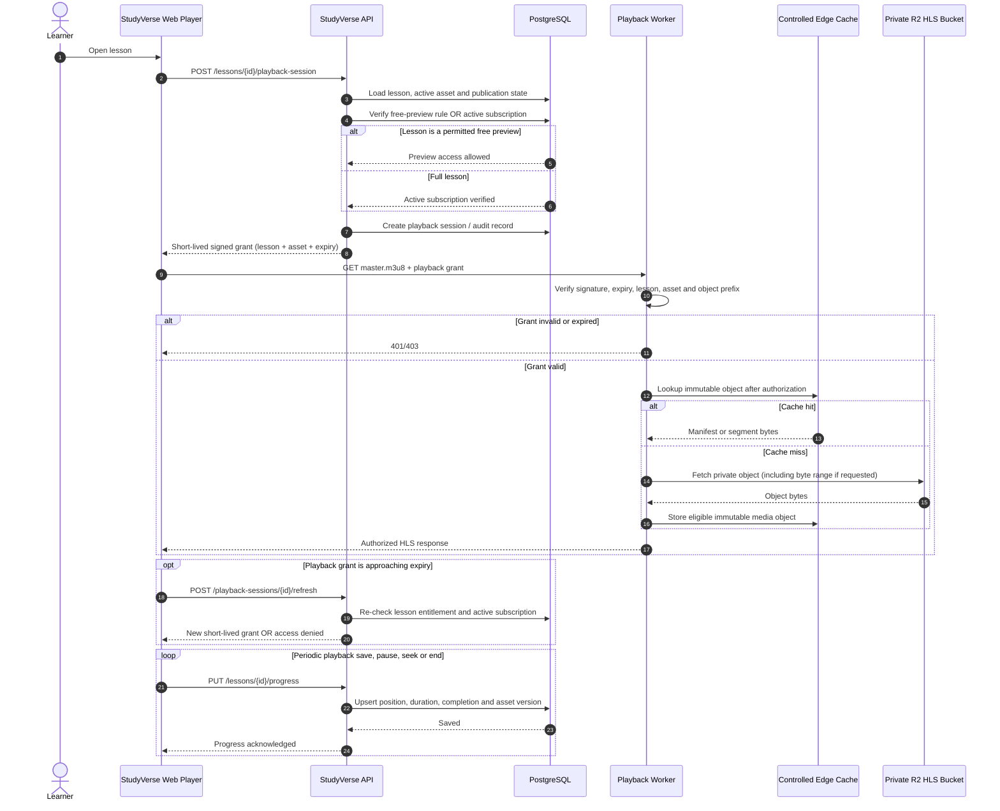
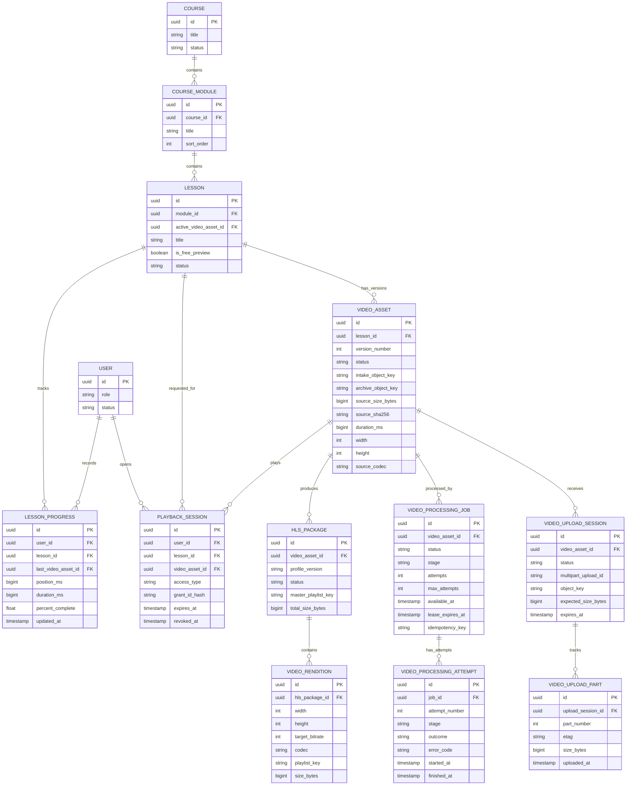
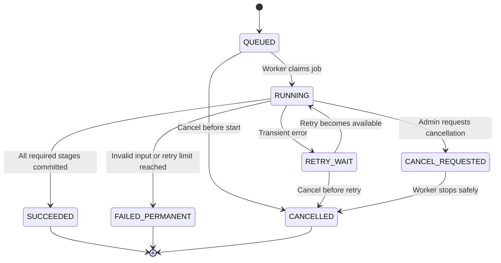
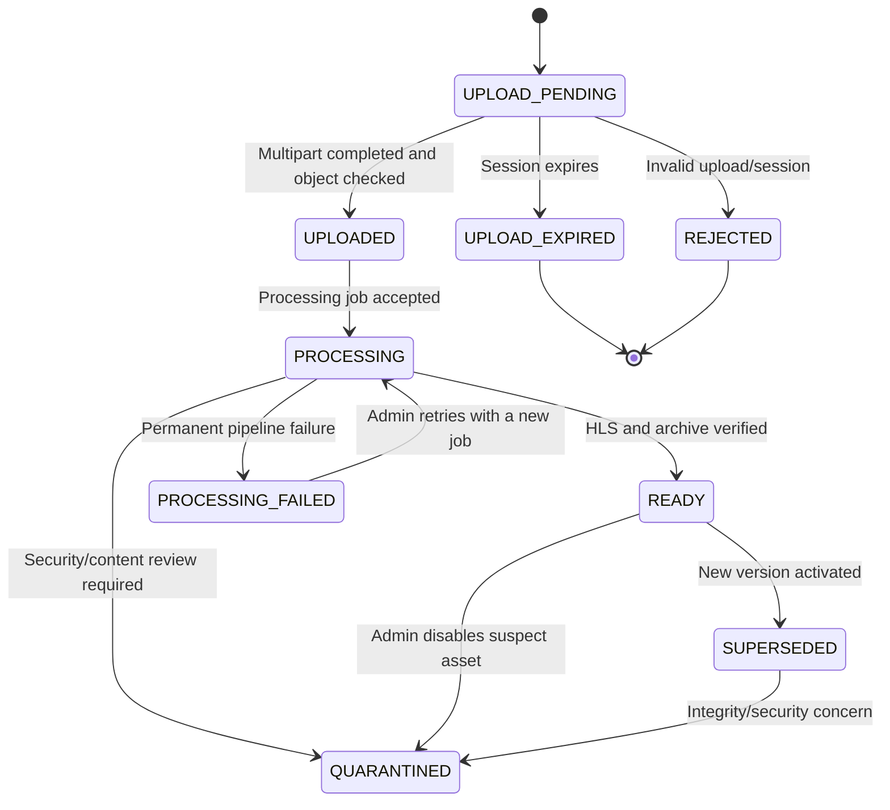

# StudyVerse — Video Pipeline Engineering Specification

**Document:** `STUDYVERSE_VIDEO_PIPELINE_SPEC.md`  
**Scope:** Production video ingestion, processing, protected playback, persistence, and recovery  
**Status:** Engineering design proposal for review  
**Product context:** StudyVerse organizes content as Course → Modules → Lessons. Visitors can watch designated free-preview lessons; full lessons require an active subscription. The current UI-first phase remains mock-data-only.

---

## 1. Decisions captured

| Area | Proposed decision |
|---|---|
| Raw upload intake | Private Cloudflare R2 bucket |
| Raw master archive | Private Backblaze B2 bucket after processing |
| Streaming format | HLS VOD |
| Initial codec | H.264 video + AAC audio |
| Rendition ladder | 1080p / 720p / 480p, only up to source resolution |
| Segment target | 4–6 seconds; keyframe-aligned across renditions |
| Processing | FFmpeg + FFprobe on a separate worker |
| Upload path | Browser → dedicated Cloudflare Worker → R2 multipart API |
| Job orchestration | Durable PostgreSQL-backed job table/queue; no Redis required for MVP |
| Application | Next.js + backend API + PostgreSQL on a cloud VPS initially |
| Playback | Private R2 origin behind a Cloudflare Worker authorization gateway |
| Authorization | Short-lived, lesson-scoped signed playback grant |
| Raw retention | Keep original masters in B2; do not delete after transcoding |
| Publication | An asset is not activated until HLS output and archived master are verified |
| Replacement | Keep the current video active until the replacement is ready and explicitly activated |

### Project-phase boundary

The existing StudyVerse product plan excludes real video upload, storage, transcoding, DRM, and protected streaming from the current Next.js UI prototype. This document describes the later production-services design. Do not connect production infrastructure merely to complete the mock-data UI phase.

### Product access rules

The existing product plan defines:
- `Course → Modules → Lessons`.
- A lesson can contain a video reference.
- One lesson per course is designated as a free preview in the initial product rules.
- Visitors and non-subscribed learners may watch that preview.
- Full lessons require an active subscription.
- Lesson playback position and progress are tracked so a learner can resume.

The backend, not the frontend, must enforce these rules. Hiding a player or URL in the UI is not access control.

## 2. Client raw-video baselines and encoding profile

Use the client-provided raw upload baselines:

| Upload class | Duration | Raw size |
|---|---:|---:|
| Minimum | 20 minutes | 1.5 GB |
| Average | 30–40 minutes | 3.0 GB |
| Maximum | 60 minutes | 5.0 GB |

Initial output ladder (planning targets, not guaranteed file sizes):

| Rendition | Target video bitrate | Audio bitrate | Resolution |
|---|---:|---:|---:|
| 1080p | 4.0 Mbps | 128 Kbps | 1920 × 1080 |
| 720p | 2.0 Mbps | 128 Kbps | 1280 × 720 |
| 480p | 1.0 Mbps | 128 Kbps | 854 × 480 |

Rules:
- Do not upscale. Generate only renditions at or below the source's native resolution.
- Preserve source frame rate initially, subject to a maximum decided after sample testing.
- Keep segment boundaries and keyframes aligned across renditions.
- Use HLS VOD playlists with a completion marker.
- Do not promise an exact output size before testing real lecture footage. Fine handwriting, diagrams, scrolling code, and dense equations may require higher bitrates.
- Start with H.264/AAC. Evaluate HEVC or AV1 later using measured quality, device compatibility, encoding time, and storage.
- Start with 4–6 second segments. FFmpeg cuts HLS segments on keyframes, so GOP/keyframe settings must be coordinated across renditions.

## 3. Component boundaries

### 3.1 Application VPS

Runs Next.js, backend API, authentication/permissions, course and lesson logic, subscriptions, progress, PostgreSQL, video metadata and job state.

Must not receive 5 GB uploads through an application request, run FFmpeg inside a web request, serve HLS segment bytes from the application process, or expose storage credentials to the browser.

### 3.2 Upload Worker

A dedicated Cloudflare Worker with access to the R2 multipart API:
- Authenticates a scoped upload-session token issued by the backend.
- Creates/resumes multipart uploads.
- Accepts bounded chunks and uploads each part to R2.
- Returns each part number and ETag.
- Completes or aborts the multipart upload.

The browser tracks progress and part results. The backend persists the multipart upload ID and acknowledged part metadata so an interrupted upload can resume.

**Important R2 implementation detail:** do not model this as one 5 GB presigned PUT or assume every multipart part has a normal presigned URL. Use the documented R2 multipart API through a Worker. Each chunk must stay within the request-body limit of the selected Workers plan. The client and backend must retain upload ID, part numbers, and ETags between requests.

### 3.3 Processing Worker

A separate compute instance running a background worker:
- Claims a durable processing job.
- Downloads the original from R2 intake.
- Validates and probes the source.
- Transcodes HLS renditions using FFmpeg.
- Uploads outputs to a private R2 staging prefix.
- Verifies playlists and segments.
- Copies the original to B2 and verifies its checksum.
- Marks the asset ready for admin publication.

Starting benchmark configuration: **8 vCPU / 16 GB RAM**, NVMe temporary workspace, and one active transcode at a time. This is a benchmark starting point, not a guaranteed throughput figure.

### 3.4 Private playback gateway

A Cloudflare Worker in front of private HLS storage:
- Validates the short-lived playback grant on every manifest and segment request.
- Verifies the requested object path belongs to the asset and lesson authorized by the grant.
- Supports GET, HEAD, and byte-range requests as required by the player.
- Only after authorization, reads from the private R2 origin or controlled edge cache.
- Does not permit direct public bucket access.

Authorization must happen before returning a cached object. Never make private paid-course files publicly retrievable simply to obtain CDN caching.

## 4. Sequence diagram — upload, transcode, archive, publish

```mermaid
sequenceDiagram
    autonumber
    actor Admin
    participant UI as Admin UI
    participant API as StudyVerse API
    participant DB as PostgreSQL
    participant UP as R2 Multipart Worker
    participant R2I as R2 Intake Bucket
    participant Q as Durable Video Job Queue
    participant TW as FFmpeg Processing Worker
    participant R2H as R2 HLS Staging
    participant B2 as B2 Master Archive

    Admin->>UI: Select lesson and choose video
    UI->>API: POST /lessons/{id}/video-uploads
    API->>DB: Check permission; create video_asset and upload_session
    API->>UP: Create multipart upload for opaque object key
    UP->>R2I: createMultipartUpload(key)
    R2I-->>UP: uploadId
    UP-->>API: uploadId and upload session handle
    API->>DB: Persist uploadId, key, expiry, expected size
    API-->>UI: Scoped upload token + chunk configuration

    loop Each file part (parallelism capped)
        UI->>UP: PUT part(upload token, uploadId, partNumber, bytes)
        UP->>R2I: uploadPart(uploadId, partNumber, bytes)
        R2I-->>UP: partNumber + ETag
        UP-->>UI: Part accepted + ETag
        UI->>API: Persist acknowledged part number, ETag, byte count
        API->>DB: Upsert video_upload_part
    end

    UI->>API: POST /video-uploads/{id}/complete
    API->>DB: Verify required parts, uploader and expiry
    API->>UP: Complete multipart(uploadId, ordered parts)
    UP->>R2I: completeMultipartUpload(...)
    R2I-->>UP: Completed object metadata
    UP-->>API: Completion result
    API->>R2I: HEAD object / validate size and metadata
    R2I-->>API: Object exists and expected size
    API->>DB: Mark upload completed; asset = uploaded
    API->>Q: Enqueue PROCESS_VIDEO (idempotency key)
    API-->>UI: Upload complete; processing queued

    Q-->>TW: Worker claims job with lease
    TW->>DB: Set job running; stage = validate_source
    TW->>R2I: Download original to temporary NVMe
    R2I-->>TW: Original bytes
    TW->>TW: Validate file signature, size, duration and codecs
    TW->>TW: FFprobe source metadata
    TW->>TW: FFmpeg H.264/AAC HLS ladder
    TW->>R2H: Upload master playlist, variant playlists, segments, poster
    R2H-->>TW: Upload acknowledgements
    TW->>R2H: Verify manifests, segment count, sizes and checksums
    R2H-->>TW: HLS package verified

    TW->>B2: Copy raw master to versioned archive key
    B2-->>TW: Upload result
    TW->>B2: Verify archived size and SHA-256 checksum
    B2-->>TW: Archive verified

    TW->>DB: Transaction: package=verified, asset=ready, job=succeeded
    DB-->>TW: Commit
    TW->>TW: Remove temporary NVMe files
    TW-->>API: Processing completed
    API-->>UI: Asset ready for admin review

    Admin->>UI: Preview and approve video version
    UI->>API: POST /lessons/{id}/video-assets/{assetId}/activate
    API->>DB: Verify ready asset; atomically swap active_video_asset_id
    DB-->>API: Active asset updated
    API-->>UI: Lesson now serves the new version
```

### Upload implementation details

1. Generate opaque object keys using asset UUIDs; never use a user-supplied filename as an object key.
2. Set a configurable maximum upload size aligned with the client's current 5 GB maximum baseline.
3. Use bounded chunks and limited concurrency. Proposed starting point: 16 MiB chunks and 3–4 parallel parts; validate against the chosen Workers plan and browser tests.
4. Return each part's ETag and persist it with its part number and size.
5. A retry re-uploads the same part number; a successful response replaces that part's stored ETag.
6. Do not treat a multipart ETag as a SHA-256 checksum. Compute a source checksum in the processing worker or use a supported verified checksum mechanism.
7. The API must verify that the upload session belongs to the authenticated admin and intended lesson before completing it.
8. Completion must be idempotent; repeated completion requests must not create duplicate assets or processing jobs.
9. Abort expired incomplete multipart uploads. Proposed initial upload-session expiry: 24 hours, configurable.

## 5. Sequence diagram — protected learner playback



### Playback authorization rules

- A visitor may receive a preview grant only for a published lesson explicitly designated as that course's free preview.
- A learner may receive a full-lesson grant only when the backend confirms an active subscription at grant issuance/refresh.
- Scope the grant to a user or guest session, lesson, immutable video asset, permitted object prefix, and expiry.
- Player refreshes before expiry. Proposed initial lifetime: 5–10 minutes.
- Validate the grant for every manifest and segment request. Never trust a lesson ID supplied only by the browser.
- Reject object keys outside the authorized asset prefix and restrict HTTP methods.
- Validate authorization before returning edge-cached media. Cache immutable segment bytes by asset/version/object key only after the access check.
- Configure CORS for exact StudyVerse player origins. CORS is not authorization.
- Use HTTPS throughout and keep signing secrets/R2 credentials server-side.
- A playback grant is not DRM. It makes casual link sharing harder and enforces subscription checks, but cannot prevent screen recording or a determined authorized learner from capturing playback.

**Subscription expiry behavior:** entitlement is checked when the session is created and refreshed. An already-issued grant may remain usable until it expires. With a 5–10 minute grant lifetime, the normal continuation window after subscription expiry/revocation is bounded by that lifetime. Document this behavior in the access policy.

## 6. Database relationship diagram

The existing `courses`, `course_modules`, `lessons`, `users`, subscriptions, and learner progress entities remain the source of course and account identity. Add media-specific tables rather than duplicating course or user records.



`LESSON.active_video_asset_id` is a nullable foreign key to `VIDEO_ASSET.id`. It identifies the asset version currently served to learners. Keep this pointer separate from uploaded versions so a new upload cannot replace a working video before processing succeeds.

### 6.1 Entity responsibilities and important fields

#### `video_assets`
One immutable source-video version for one lesson.

Fields:
- `id`, `lesson_id`, `version_number`, `status`
- `original_filename` (display/audit only, never used as storage key)
- `source_content_type`, `source_size_bytes`
- `intake_bucket`, `intake_object_key`, `source_sha256`
- `duration_ms`, `width`, `height`, `frame_rate_num`, `frame_rate_den`
- `source_video_codec`, `source_audio_codec`
- `archive_provider`, `archive_bucket`, `archive_object_key`, `archive_sha256`, `archived_at`
- `created_by`, `created_at`, `updated_at`

Constraints:
- Unique `(lesson_id, version_number)`.
- Unique immutable object key per asset version.
- `READY` requires a verified HLS package and verified archived master.
- Never overwrite an existing asset version's source object in place.

#### `video_upload_sessions`
Tracks one multipart upload attempt: `id`, `video_asset_id`, `provider_upload_id`, `object_key`, `status`, expected/actual size, expiry, completed/aborted timestamps, and creator. Do not store long-lived presigned URLs or upload bearer tokens. Persist the multipart upload ID and session metadata; issue short-lived authorization when needed.

#### `video_upload_parts`
Tracks acknowledged parts: `upload_session_id`, `part_number`, `etag`, `size_bytes`, `uploaded_at`. Unique `(upload_session_id, part_number)`. Client-local progress helps resume, but backend records are canonical for completion. A successful retry replaces the ETag for that part number.

#### `video_processing_jobs`
Application-owned durable record of the processing job: `id`, `video_asset_id`, `job_type`, `status`, `stage`, `progress_percent`, `attempts`, `max_attempts`, `available_at`, `lease_owner`, `lease_expires_at`, `heartbeat_at`, `idempotency_key`, sanitized last error, timestamps.

Use an indexed query for eligible queued/due retry jobs and claim work transactionally with row locking (`FOR UPDATE SKIP LOCKED`), or use a mature PostgreSQL-backed job runner. Do not add Redis only to run this small initial queue.

#### `video_processing_attempts`
Append-only history for each worker attempt: job/attempt number, worker identifier, software/encoder version, stage timestamps, outcome, error classification, FFmpeg exit code, duration, and a log object key or trace ID. Do not store huge FFmpeg logs inside PostgreSQL rows.

#### `hls_packages` and `video_renditions`
One HLS package belongs to one immutable source asset and one encoding-profile version. Store master playlist key, package status, total bytes, and per-rendition dimensions, codec, bitrate, playlist key, segment count, bytes and verification status.

Do not create one database row per HLS segment. The playlist and object storage are the segment index; PostgreSQL stores package/rendition metadata.

#### `playback_sessions`
Tracks grant issuance for auditing, refresh and optional revocation. Store the grant ID hash, not the raw bearer token. A Worker can validate a short-lived signed grant without querying PostgreSQL for every segment.

#### `lesson_progress`
Reuse the existing progress concept and add `last_video_asset_id`. This identifies which video version the saved position belongs to. On replacement, clamp/reset invalid positions; do not seek beyond the new duration. Preserve lesson completion according to the existing product policy.

## 7. Job state machine

Keep the overall job **status** separate from the detailed processing **stage**.

### 7.1 Overall job states



A completed, failed, or cancelled job is terminal. To process the same asset again, create a new job with a new idempotency key/reprocess revision. Do not reopen a terminal job and erase its history.

### 7.2 Processing stages

1. `VALIDATE_SOURCE`
2. `DOWNLOAD_SOURCE`
3. `PROBE_SOURCE`
4. `TRANSCODE_HLS`
5. `UPLOAD_HLS_STAGING`
6. `VERIFY_HLS`
7. `ARCHIVE_MASTER`
8. `VERIFY_ARCHIVE`
9. `COMMIT_ASSET_READY`
10. `CLEANUP_TEMPORARY_FILES`

Stage is a progress marker, not another job status.

### 7.3 Video asset states



The currently served version is determined by `lesson.active_video_asset_id`, not by copying an `ACTIVE` status across asset rows. A ready asset may wait for admin approval before it becomes active.

## 8. Failure, retry, timeout and recovery policy

| Failure | Classification | Automatic response | Admin action |
|---|---|---|---|
| Upload part network timeout | Transient | Retry same part number; keep successful parts | Resume if session is still valid |
| Browser closes mid-upload | Recoverable | Keep session/parts until expiry | Resume or abort/restart |
| Upload session expires | Terminal for session | Abort incomplete multipart upload; mark expired | Create new upload session |
| Completion request repeated | Duplicate/idempotent | Return prior result; do not duplicate asset/job | None |
| Source missing or size mismatch | Integrity | Retry HEAD/completion verification briefly, then fail | Re-upload source |
| Unsupported codec/container or corrupt source | Permanent input error | Do not retry identical source repeatedly | Upload valid replacement |
| FFprobe/FFmpeg crash | Usually transient | Bounded retry with backoff; preserve error/log | Inspect if repeated |
| Worker disappears | Recoverable | Lease expiry makes job eligible for retry | Alert on repeated failures |
| Temporary disk full | Resource failure | Stop; do not loop retries | Increase disk/reduce concurrency |
| HLS output fails verification | Processing failure | One controlled re-encode retry may be allowed | Review source/profile if it fails again |
| R2 staging upload timeout | Transient | Retry upload; verify object state first | None unless exhausted |
| B2 archive unavailable | Transient archive failure | Retry archive stage only; do not re-transcode | Alert if prolonged |
| Archive checksum mismatch | Integrity | Retry copy/verification; never delete intake source | Investigate and re-copy |
| DB commit fails after output upload | Transient | Retry idempotent finalization | Reconciler checks object and DB state |
| Lesson archived during processing | Business-state change | Finish safely or cancel; never publish archived lesson | Admin chooses whether to restore |
| Replacement upload fails | Processing failure | Leave old active asset unchanged | Retry or upload a new version |
| Playback grant expires | Authorization expiry | Player requests refresh; API re-checks entitlement | Learner renews if inactive |
| Subscription revoked mid-playback | Authorization change | Deny next refresh; current grant ends at expiry | Admin handles subscription |
| Temporary-object cleanup fails | Non-critical | Retry cleanup separately | Alert only after retention threshold |

### 8.1 Retry schedule

Initial policy:
- Maximum 4 total attempts for retryable processing failures (one initial attempt plus up to three retries).
- Exponential delays around 1 minute, 5 minutes, and 20 minutes, with jitter.
- Permanent input errors are not retried.
- Resource-limit errors are not blindly retried until capacity/configuration is corrected.
- Admin reprocessing creates a new job and preserves prior job history.

Tune limits after measuring real FFmpeg runtime and failure rates.

### 8.2 Worker leases and recovery

- A worker claims one job and sets `lease_owner`, `lease_expires_at`, and `heartbeat_at`.
- Worker renews its lease periodically.
- If it dies, a reconciler detects an expired lease and moves the job to `RETRY_WAIT`.
- Only the current lease owner may update a running job.
- Every worker mutation includes job ID, current attempt number and lease owner so a stale worker cannot publish after another worker reclaimed the job.

### 8.3 Idempotency requirements

Idempotency is mandatory for upload completion, processing-job creation, worker-stage outputs, HLS finalization, raw archive copy, active-asset swap, and cleanup.

Use immutable object keys containing asset ID, package/profile version and job/attempt ID for temporary staging. Never let two attempts write to the same partially completed staging prefix.

## 9. Processing and publication rules

### 9.1 Input validation

Before encoding:
- Confirm upload session and expected object key.
- Confirm object exists and size matches completed upload.
- Check file signature/container; do not trust browser MIME type or extension.
- Run FFprobe in a restricted worker environment.
- Reject zero-length, corrupt, unsupported, or unexpectedly long inputs.
- Apply resource and execution-time limits.
- Run as an unprivileged worker with no public inbound endpoint and only required storage permissions.
- Keep FFmpeg and its libraries patched.

Treat uploaded media as untrusted input. A valid admin account does not make a file safe to parse.

### 9.2 Suggested object-key layout

```text
intake/{assetId}/original

hls-staging/{assetId}/{jobId}/
  master.m3u8
  1080p/index.m3u8
  1080p/segment_00001.m4s
  720p/index.m3u8
  720p/segment_00001.m4s
  480p/index.m3u8
  480p/segment_00001.m4s
  poster.jpg

hls/{assetId}/{profileVersion}/...

masters/{lessonId}/{assetId}/original
```

Actual object keys are generated by the backend. Never derive them from client filenames.

### 9.3 HLS verification

Before setting the asset to `READY`, verify:
- Master playlist exists and references only expected rendition playlists.
- Every advertised rendition playlist exists.
- Every segment referenced by each playlist exists.
- Segment counts and total sizes are plausible.
- Playlists are valid VOD playlists with a completion marker.
- Rendition timelines/keyframe alignment are coherent.
- A smoke-test decode of representative segments succeeds.
- Archive copy exists and matches the source checksum.

Do not expose partially uploaded playlists or segments to learners.

### 9.4 Publish and replace

Processing success means **READY**, not automatically **LIVE**.

1. Admin sees processing success.
2. Admin previews the new video.
3. Admin clicks **Activate video version**.
4. API verifies the asset is `READY` and belongs to the lesson.
5. In one database transaction, update `lesson.active_video_asset_id`.
6. Old asset becomes superseded but remains available for rollback/retention.

For a new lesson with no active video, activation assigns the first ready asset. For a replacement, the old asset remains live until the swap succeeds.

### 9.5 Archive and cleanup

- Never delete the intake source until B2 archive verification succeeds.
- Keep raw master archive keys immutable.
- Keep failed staging outputs for a short diagnostic retention window, then clean them.
- Keep superseded HLS packages for a rollback window (proposed initial default: 30 days) before deletion.
- Retain raw masters according to the platform's content-retention policy.
- Expire/abort incomplete multipart uploads after the configured upload-session window.
- Cleanup failure must not turn a published asset back into a failed asset; cleanup is a separate recoverable task.

## 10. Playback progress and learner experience

- Backend is authoritative for subscription entitlement and lesson access.
- Save current position periodically (for example every 20–30 seconds) and on pause, seek, lesson end, and page exit where possible.
- Debounce progress writes; seeking must not generate a database write per frame.
- Store `position_ms`, `duration_ms`, and `last_video_asset_id`.
- Mark completion using the product's defined completion rule, with manual completion supported as described in the product plan.
- If the active video asset changes, compare saved asset ID. Clamp/reset invalid positions and avoid seeking beyond the new duration.
- On `401/403`, pause playback and request grant refresh. If entitlement is no longer valid, show the appropriate access/subscription message instead of retrying media requests forever.

## 11. Security and operational controls

### Upload security
- Admin authentication and permission check before creating an upload session.
- Short-lived, scoped upload-session token bound to one asset, object key and expiry.
- CORS allowlist limited to StudyVerse domains.
- Chunk-size and maximum-file-size limits.
- Server-side validation of part numbers, upload ID, object key and session ownership.
- Rate-limit upload-session creation and completion.
- Do not expose storage credentials or allow arbitrary bucket/key selection.

### Processing security
- Worker has read access to intake, write access to HLS staging, and only required B2 archive permissions.
- No database superuser credentials in the worker.
- Run media parsing in an isolated, unprivileged process/container.
- Bound CPU, RAM, temporary disk and execution time.
- Record encoder and profile version for reproducibility.
- Keep secrets out of FFmpeg command-line arguments and logs.

### Playback security
- Private R2 buckets.
- Short-lived signed authorization scoped to asset/lesson.
- Validate authorization before object/cache retrieval.
- Restrict paths, methods, origins and response headers.
- Support byte-range requests where required by player/browser.
- Avoid raw long-lived tokens in analytics logs or referrer-visible URLs.
- Signed access is not DRM and cannot stop screen recording.

### Monitoring and alerting
Track upload failures/expiry, upload duration, retry count, queue depth/oldest job age, job duration by stage, worker heartbeat/lease expiry, FFmpeg exit codes/failure rate, output bytes per source minute, archive success/checksum mismatch, playback authorization denials, HLS 4xx/5xx, playback startup/rebuffering, storage/request/cache metrics, PostgreSQL size, backup age and restore-test results.

Alert on growing queue, repeated failed assets, stale worker heartbeat, missing archive verification and abnormal playback failures.

## 12. Recommended MVP operating configuration

| Component | Starting configuration |
|---|---|
| Application VPS | 2 vCPU / 4 GB RAM |
| PostgreSQL | Same VPS initially with scheduled encrypted backups; split when metrics justify it |
| Upload | Cloudflare Worker multipart API; browser sends bounded chunks |
| Upload chunk size | Start around 16 MiB; verify current Workers plan request-body limits |
| Upload concurrency | 3–4 parts at a time initially |
| Maximum upload | Configurable; initial default aligned to 5 GB raw baseline |
| Transcoding worker | 8 vCPU / 16 GB RAM starting benchmark |
| Concurrent transcodes | 1 initially |
| Encoding | H.264 + AAC, 1080p / 720p / 480p where source supports each |
| HLS segment target | 4–6 seconds, aligned keyframes |
| HLS storage | Private Cloudflare R2 bucket |
| Raw archive | Private Backblaze B2 bucket |
| Playback | Worker validates signed grant before serving private HLS objects |
| Playback grant | 5–10 minute initial expiry; refresh requires entitlement check |
| Progress update | Every 20–30 seconds plus pause/seek/end events |
| Worker retry | 4 total attempts for retryable failures, exponential backoff + jitter |
| Upload session expiry | 24 hours proposed initial default |
| Superseded HLS retention | 30 days proposed initial rollback window |

These are starting defaults. Benchmark representative lessons and check current Workers plan limits before finalizing chunk size and concurrency.

## 13. Acceptance criteria before production release

### Upload
- [ ] 1.5 GB, 3 GB and 5 GB source files can be uploaded.
- [ ] Upload chunks retry independently.
- [ ] Browser refresh/reconnect can resume an unexpired multipart upload.
- [ ] Expired multipart sessions are aborted and cleaned up.
- [ ] Duplicate completion requests do not create duplicate assets/jobs.
- [ ] Upload requests do not pass through the Next.js/API VPS.

### Processing
- [ ] A representative source produces every applicable rendition.
- [ ] Lower-resolution source files are not upscaled.
- [ ] Queue survives app/worker restarts.
- [ ] Worker crash and lease expiry cause safe retry.
- [ ] Failed HLS verification prevents publication.
- [ ] B2 archive checksum verification is required before asset readiness.
- [ ] Temporary processing files are cleaned up safely.

### Publishing
- [ ] A ready asset can be previewed before activation.
- [ ] A failed replacement never breaks the currently active lesson video.
- [ ] Activating a replacement updates the active asset atomically.
- [ ] Superseded version remains recoverable during rollback window.

### Playback and access
- [ ] Visitor can play only designated published previews.
- [ ] Non-subscribed learner cannot play full lessons.
- [ ] Active learner can play full lessons.
- [ ] Expired/revoked subscription cannot refresh playback authorization.
- [ ] Manifest and segment URLs fail without valid authorization.
- [ ] Seeking and required range behavior work.
- [ ] Token refresh works during long lessons.
- [ ] Progress resumes after reload and across video version changes.

### Operations
- [ ] Alerts fire for stale jobs, archive failures and queue buildup.
- [ ] Database backup has been restored in a test environment.
- [ ] B2 master archive recovery has been tested.
- [ ] Storage keys and credentials are not present in client bundles or logs.

## 14. Decisions to lock before implementation

1. **Upload worker route:** Use a Cloudflare Worker with the R2 binding multipart API (recommended) rather than sending a 5 GB file to the application server. Confirm the selected Workers plan and part-size limit.
2. **Player library:** Select after testing Safari native HLS and Chromium/Firefox. A common choice is hls.js for MSE-capable browsers with native-HLS fallback.
3. **Authorization transport:** Choose a same-site secure HttpOnly signed cookie or signed per-request token strategy. Test credentials on both native HLS and hls.js.
4. **Progress completion rule:** Confirm completion percentage/time threshold and manual completion semantics.
5. **Retention policy:** Confirm retention for superseded HLS versions, failed staging output, raw masters and playback audit records.
6. **Archive outage policy:** This design keeps an asset unpublished until its master is safely archived. Confirm that this stricter reliability rule is acceptable.

Recommended defaults are provided in Sections 12 and 13.

## 15. Technical references

Use current provider documentation during implementation because provider APIs and plan limits can change.

- Cloudflare R2 multipart API through Workers: https://developers.cloudflare.com/r2/api/workers/workers-multipart-usage/
- Cloudflare R2 presigned URLs and supported operations: https://developers.cloudflare.com/r2/api/s3/presigned-urls/
- Cloudflare R2 browser CORS: https://developers.cloudflare.com/r2/buckets/cors/
- Cloudflare R2 architecture patterns (multipart, authorization and caching): https://github.com/cloudflare/skills/blob/main/skills/cloudflare/references/r2/patterns.md
- Cloudflare Worker signed-request example: https://developers.cloudflare.com/workers/examples/signing-requests/
- FFmpeg HLS muxer documentation: https://ffmpeg.org/ffmpeg-formats.html#hls-2

## 16. Final engineering recommendation

Build around immutable video asset versions, a durable processing job record, an isolated FFmpeg worker, private HLS storage, a private raw-master archive, and a playback gateway that checks authorization before every media response.

Three invariants must hold:

1. A lesson's current video is never replaced until a new version is fully processed, verified, archived and activated.
2. No learner receives media access merely because they know an object URL; every playback request is authorized against the lesson grant.
3. A failed upload, worker restart or archive outage never silently publishes incomplete media or destroys the last working version.

Implement this after the StudyVerse UI flows are approved.
