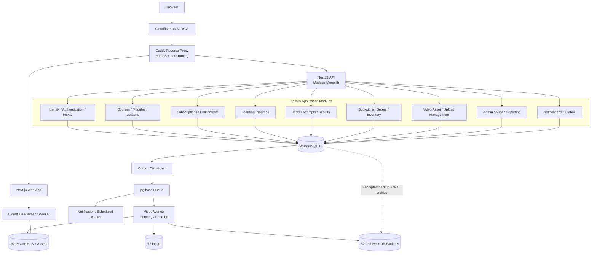

# StudyVerse — Backend Architecture

**Document:** `Backend_architecture.md`  
**Status:** Proposed architecture for review before implementation  
**Product:** StudyVerse  
**Scope:** Production backend foundation for learning, assessments, subscriptions, bookstore, and video delivery  
**Last updated:** 20 November 2026

---

## 1. Executive decision

Build a **self-managed NestJS modular monolith backed by PostgreSQL**, rather than self-hosting the complete Supabase platform.

The application will own its business rules, authentication, authorization, APIs, database migrations, and operational workflows. Managed object storage remains responsible for large media objects and off-site backups.

### Recommended stack

| Layer | Technology | Responsibility |
|---|---|---|
| Frontend | Existing Next.js + TypeScript | Public site, learner experience, admin workspace |
| Backend API | NestJS + TypeScript | Application APIs and business rules |
| Runtime | Node.js 22 LTS, latest patched 22.x | Production runtime |
| Database | PostgreSQL 18.x, latest patched 18.x | Primary relational data store |
| ORM | Prisma ORM 7 stable + PostgreSQL driver adapter | Typed queries and migrations |
| Authentication | Passport + local password strategy + Google OIDC | Sign-in and identity |
| Browser sessions | `express-session` + PostgreSQL-backed session store | Secure, revocable browser sessions |
| Password hashing | Argon2id | Password storage |
| Background jobs | pg-boss | Durable queue, retries, schedules |
| Video processing | FFmpeg + FFprobe | HLS generation and validation |
| Video upload/delivery | Cloudflare R2 + Workers | Multipart upload and protected HLS delivery |
| Raw video archive | Backblaze B2 | Immutable source-video masters |
| Database backups | pgBackRest/WAL archive to off-site object storage | Recovery and point-in-time restore |
| Reverse proxy/TLS | Caddy | HTTPS termination and routing |
| Container deployment | Docker Compose | Application and infrastructure processes |
| API contract | REST + OpenAPI/Swagger | Versioned API and documentation |
| Logging | Structured JSON logging with Pino | Operational diagnostics |
| Testing | Jest/Supertest + Playwright | Unit, integration, and browser tests |

### What this decision means

- No Supabase subscription is required.
- No Supabase clone is being built.
- No Neon dependency is required.
- No Redis is required initially.
- No microservices are required initially.
- The application starts as one modular API codebase.
- Video transcoding runs in a separate process/container and on separate compute when production video is enabled.
- The existing `PLAN.md` remains a product/UI plan and is not rewritten as part of this architecture work.

---

## 2. Product scope the backend must support

This architecture consolidates the agreed StudyVerse product requirements.

### 2.1 Learning platform

- India-focused platform, initially English-only.
- Account types and roles: Visitor (anonymous), Learner, Owner, Staff Admin.
- Content hierarchy: `Course → Modules → Lessons`.
- Courses can be associated with one or more exam categories and subjects.
- Courses have Draft, Published, and Archived lifecycle states.
- Initial product rule: one designated free-preview lesson per course.
- Visitors can browse public content and watch designated previews.
- One designated free demo test is available without registration.
- Full lessons and regular published tests require an active all-access subscription.
- Expired subscriptions remove paid access but do not delete learner accounts, historical progress, or exam attempts.
- Learners can resume lessons and track completion.
- Owner-managed invitations create Staff Admin accounts; public admin registration is not allowed.

### 2.2 Subscription workflow

- One all-access plan initially.
- Admin-configurable 30-, 90-, and 365-day durations and prices.
- Learner makes payment outside the platform using UPI/bank transfer.
- Learner submits payment method, amount, transaction reference, and optional screenshot.
- Admin verifies actual payment outside StudyVerse.
- Only admin approval activates access.
- Rejected requests show a reason; learner can submit a new request.
- Only one pending request per learner.
- Renewal extends an existing active expiry rather than discarding unused time.

### 2.3 Assessments

- Tests can be standalone or associated with exam categories, subjects, and courses.
- Question types: single-correct MCQ, multi-select MCQ, numerical answer.
- Configurable sections, timing, marking, negative marking, attempt limits, and result release.
- Overall timer or section timers.
- Server-authoritative attempt start and submission.
- Historical attempts retain the exact published test version, questions, options, correct answers, and marking configuration.
- One free demo test can be attempted by anonymous visitors.
- Regular tests require an active subscription.

### 2.4 Bookstore

- Physical books only initially.
- Browsing is public; checkout requires a learner account.
- An active learning subscription is not required to purchase books.
- Product/edition/language combinations are separate product records.
- Multiple product photos with one primary cover image.
- Manual UPI/bank payment and admin verification.
- Stock reservation, inventory adjustments, fulfilment, tracking, cancellations, returns, refunds, and audit history.
- Product-level MRP/selling-price discounts; no coupon engine initially.
- India-wide delivery intent.

### 2.5 Video pipeline

- Direct multipart uploads to private R2 intake.
- Processing through a separate FFmpeg worker.
- H.264/AAC HLS output at 1080p, 720p, and 480p when supported by the source.
- Private HLS objects delivered through a Worker authorization gateway.
- Raw source-video masters archived in B2.
- Immutable asset versions; a failed replacement never breaks the current active lesson video.
- Durable processing job state, bounded retries, worker leases, checksum verification, and cleanup.

### 2.6 Phase boundary

The current UI-first phase remains Next.js with mock/fake data only. The backend described here is for the later production-engineering phase, after the UI and user journeys are reviewed. Do not connect real authentication, database, upload, payment, video, or notification services to the prototype prematurely.

---

## 3. System architecture

### 3.1 Logical architecture



### 3.2 Request flow

1. The browser loads the Next.js site through Caddy.
2. Browser API requests use the same public origin under `/api/v1`.
3. Caddy routes `/api/*` to NestJS and normal page routes to Next.js.
4. NestJS authenticates the browser session, checks permission and entitlement, validates input, and executes the use case.
5. Prisma communicates with PostgreSQL.
6. Long-running or retryable work is written to a transactional outbox and dispatched to pg-boss.
7. Separate worker processes execute background tasks.
8. Large video files and HLS segments never pass through the NestJS HTTP process.

### 3.3 Deployment boundary

Initial deployment is cost-optimized and intentionally not highly available. A single VPS failure can make the app and primary database unavailable. Off-site backups and tested recovery reduce data-loss risk but do not provide zero-downtime failover.

---

## 4. Architecture style: modular monolith

Use one NestJS repository and one PostgreSQL database with clearly separated domain modules.

Do not split every product feature into a separate service. The domains have transactional relationships, and the early product does not have the traffic or team size that justifies distributed services.

### Module boundaries

| Module | Owns | Does not own |
|---|---|---|
| Identity | Users, credentials, OAuth identities, sessions, account state | Course entitlements |
| Authorization | Roles, permissions, admin invitations, policy checks | Password verification |
| Catalog | Exam categories, subjects, courses, modules, lessons | Video bytes |
| Subscriptions | Plans, activation requests, subscription periods | Authentication sessions |
| Entitlements | Centralized lesson/test access decisions | UI display state |
| Progress | Lesson positions and completion | Video object files |
| Video Assets | Asset versions, upload sessions, playback grants and metadata | FFmpeg execution itself |
| Video Processing | Job lifecycle and worker coordination | Course publication policy |
| Assessments | Tests, versions, sections, questions, attempts and grading | Subscription payment |
| Bookstore | Products, inventory, carts, orders, payments, fulfilment and returns | Learning subscriptions |
| Notifications | In-app notifications, email delivery requests and outbox events | Business-state ownership |
| Audit | Sensitive business and admin action records | Operational application logs |
| Reports | Read-oriented operational summaries | Primary write workflows |

### Module dependency rules

- Modules expose application services/use cases, not their Prisma repositories.
- A module must not directly update another module's tables.
- Cross-module behavior is invoked through exported application services or domain events.
- Avoid circular NestJS module imports.
- Shared code is limited to primitives such as IDs, pagination, clocks, money types, error types, and transaction abstractions.
- Do not build a generic repository abstraction around every Prisma model. Use Prisma directly inside the owning module's persistence layer.

---

## 5. Repository and runtime layout

Recommended monorepo layout:

```text
studyverse/
├── apps/
│   ├── web/                       # Existing Next.js frontend
│   ├── api/                       # NestJS HTTP application
│   ├── worker/                    # Background worker process
│   └── scripts/                   # Admin/maintenance scripts
├── packages/
│   ├── api-contracts/             # Shared generated API types, if needed
│   ├── config/                    # Shared lint/TypeScript configuration
│   └── observability/             # Shared logging/trace helpers
├── prisma/
│   ├── schema.prisma
│   ├── migrations/
│   └── seed/
├── infra/
│   ├── compose.yaml
│   ├── compose.production.yaml
│   ├── Caddyfile
│   ├── postgres/
│   └── backup/
├── docs/
│   ├── Backend_architecture.md
│   └── STUDYVERSE_VIDEO_PIPELINE_SPEC.md
├── .github/workflows/
├── .env.example
├── package.json
└── README.md
```

The precise workspace tool (npm workspaces, pnpm, or another Node workspace manager) can be selected during repository setup. Do not create separate repositories for API and worker yet.

### NestJS API module structure

```text
apps/api/src/
├── main.ts
├── app.module.ts
├── config/
├── common/
│   ├── decorators/
│   ├── guards/
│   ├── filters/
│   ├── interceptors/
│   ├── pipes/
│   ├── pagination/
│   └── errors/
├── identity/
├── authorization/
├── admin/
├── catalog/
├── subscriptions/
├── entitlements/
├── progress/
├── video-assets/
├── assessments/
├── bookstore/
├── notifications/
├── audit/
├── reports/
├── outbox/
└── database/
    ├── prisma.module.ts
    └── prisma.service.ts
```

Each business module can use this structure where it adds value:

```text
<module>/
├── <module>.module.ts
├── presentation/
│   ├── http/controllers/
│   └── http/dto/
├── application/
│   ├── commands/
│   ├── queries/
│   └── services/
├── domain/
│   ├── entities/
│   ├── value-objects/
│   ├── policies/
│   └── events/
└── infrastructure/
    ├── persistence/
    └── integrations/
```

Do not mechanically create empty folders for every module. Use the separation where it protects domain logic and testing.

### Worker layout

```text
apps/worker/src/
├── main.ts
├── worker.module.ts
├── config/
├── queues/
│   ├── pg-boss.module.ts
│   └── job-names.ts
├── video/
│   ├── video.processor.ts
│   ├── source-validator.ts
│   ├── ffprobe.service.ts
│   ├── ffmpeg.service.ts
│   ├── hls-verifier.service.ts
│   └── archive.service.ts
├── notifications/
├── scheduled/
└── health/
```

The worker is a different process from the API. It can share modules and types but has its own resource limits and deployment lifecycle.

---

## 6. Runtime and dependency baseline

### 6.1 Runtime versions

| Component | Baseline |
|---|---|
| Node.js | Node 22 LTS, latest patched 22.x |
| NestJS | Stable release compatible with Node 22; pin exact version after integration tests |
| PostgreSQL | 18.x stable, latest patched 18.x |
| Prisma | 7.x stable |
| TypeScript | Strict mode enabled |
| Docker Engine / Compose | Current supported stable release |

Version policy as of 20 November 2026:
- Use a supported Node LTS line and its latest security patch.
- Use PostgreSQL 18 for the initial baseline; do not adopt a just-released major until Prisma, drivers, extensions, backups and migration tooling are validated.
- Use stable Prisma 7 rather than a release candidate. Prisma 7 uses driver adapters for direct database connections and an ESM-oriented setup.
- Pin versions with lockfiles and use automated dependency-update pull requests.
- Do not use floating `latest` tags for production containers.

### 6.2 Core packages

| Purpose | Package / technology |
|---|---|
| API framework | `@nestjs/core`, `@nestjs/common`, `@nestjs/platform-express` |
| Authentication | `@nestjs/passport`, `passport`, `passport-local`, maintained Google OIDC strategy |
| Browser sessions | `express-session`, `connect-pg-simple` or equivalent maintained PostgreSQL session store |
| Password hashing | `argon2` |
| Validation | `class-validator`, `class-transformer`, Nest `ValidationPipe` |
| ORM | `prisma`, `@prisma/client`, `@prisma/adapter-pg`, `pg` |
| Job queue | `pg-boss` |
| Logging | `nestjs-pino`, `pino` |
| Rate limiting | `@nestjs/throttler` |
| Security headers | `helmet` |
| API documentation | `@nestjs/swagger` |
| Health checks | `@nestjs/terminus` |
| Object storage | AWS SDK v3 S3 client with R2/B2 endpoints |
| Testing | Jest, Supertest, Playwright |

Keep the package list small. Add a library only when it provides a real capability required by the product.

---

## 7. Database architecture

### 7.1 Database choice

Use one PostgreSQL 18 database for the initial application.

- One database cluster and one application database.
- One default schema initially; logical boundaries are enforced through NestJS modules and table ownership.
- UUID primary keys for application entities.
- `timestamptz` timestamps stored in UTC.
- Convert to `Asia/Kolkata` only for display, reports and business communication.
- Use database constraints for uniqueness, non-null fields, foreign keys and invariants.
- Use transactions for multi-record business operations.
- Keep video bytes, PDFs and user-uploaded images in object storage, not PostgreSQL large objects.

Do not introduce multiple PostgreSQL schemas solely to imitate microservices. They add migration and relationship complexity without improving the initial deployment.

### 7.2 Prisma configuration

Use Prisma 7 stable with the PostgreSQL driver adapter.

- Use `prisma/schema.prisma` as the model contract.
- Configure Prisma CLI using `prisma.config.ts`.
- Use `@prisma/adapter-pg` for direct PostgreSQL connections.
- Use ESM (`"type": "module"`).
- Use Prisma Migrate for versioned migrations.
- Use `prisma migrate dev` only against development databases.
- Use `prisma migrate deploy` in deployment.
- Do not use `db push` as the production migration mechanism.
- Do not run destructive resets against production.
- Review generated SQL for locks, data backfills, large indexes and destructive changes.
- Add handwritten SQL migrations for PostgreSQL features/constraints not fully represented by Prisma schema syntax.

### 7.3 Domain table inventory

This is an architectural inventory, not the final DDL. Detailed columns, keys and constraints belong in the database-schema implementation task.

#### Identity and authorization

| Table | Purpose |
|---|---|
| `users` | Account identity, primary email, display profile, status |
| `user_credentials` | Password hash and credential metadata |
| `oauth_accounts` | Provider identity, provider subject, linked user |
| `sessions` | Persistent server-side browser sessions |
| `email_verification_tokens` | Hashed, single-use email verification tokens |
| `password_reset_tokens` | Hashed, single-use password reset tokens |
| `roles` | Owner, Staff, Learner role definitions |
| `permissions` | Granular application permissions |
| `role_permissions` | Permission assignments to roles |
| `user_roles` | User role assignments |
| `admin_invitations` | Owner-issued staff invitations |
| `auth_events` | Login, logout, reset, MFA and security events |

#### Catalog and learning

| Table | Purpose |
|---|---|
| `exam_categories` | JEE Main, JEE Advanced, MHT-CET and future categories |
| `subjects` | Mathematics, Physics, Chemistry, etc. |
| `courses` | Course metadata and publication state |
| `course_exam_categories` | Many-to-many course classification |
| `course_subjects` | Many-to-many subject classification |
| `course_modules` | Ordered modules within courses |
| `lessons` | Ordered lessons, preview flag and publication state |
| `lesson_resources` | Notes, PDFs, worksheets and external resources |
| `lesson_progress` | Learner resume position, completion and last asset version |

#### Subscription and entitlement

| Table | Purpose |
|---|---|
| `subscription_plans` | All-access plan and configurable durations/prices |
| `subscription_requests` | Learner activation/renewal payment submissions |
| `subscription_periods` | Approved start/end periods |
| `subscription_request_events` | Approval/rejection history and admin decisions |

The entitlement service determines access from valid subscription periods and preview rules. Do not rely on a frontend flag or manually updated `users.is_subscribed` boolean.

#### Assessments

| Table | Purpose |
|---|---|
| `tests` | Test identity, classification and lifecycle |
| `test_versions` | Immutable published test configuration |
| `test_sections` | Section order and timing configuration |
| `question_bank_items` | Reusable editable source questions |
| `question_options` | Source options for supported question types |
| `test_version_questions` | Frozen question/option/marking snapshot in a published version |
| `test_version_sections` | Frozen section composition and timing |
| `test_attempts` | Learner or anonymous attempt and exact version reference |
| `attempt_answers` | Saved learner responses |
| `attempt_question_states` | Visited, answered, review and navigation states |
| `attempt_results` | Final score, counts and score breakdown |
| `result_release_events` | Admin control over detailed solution visibility |

Published versions must be immutable. Editing a published test creates a new version. Every submitted attempt refers to exactly one immutable version. Correct answers and scoring rules must not be sent in learner-facing payloads before the answer-release policy permits it.

#### Video and media

| Table | Purpose |
|---|---|
| `video_assets` | Immutable uploaded source-video versions and metadata |
| `video_upload_sessions` | Multipart upload IDs, status, expected size and expiry |
| `video_upload_parts` | Part number, ETag and acknowledged bytes |
| `video_processing_jobs` | Domain-level job state, stage, lease, retry and idempotency |
| `video_processing_attempts` | Append-only worker attempt and failure history |
| `hls_packages` | Verified HLS package and profile version |
| `video_renditions` | Resolution, codec, bitrate, playlist key and bytes |
| `playback_sessions` | Grant issuance metadata, expiry and revocation |
| `media_assets` | Generic file metadata for non-video resources, if useful |

`lessons.active_video_asset_id` references the immutable asset version currently served. Keep asset version history separate from the currently active pointer.

Do not create a database row for every HLS segment. Store playlists and segment objects in R2; persist package and rendition metadata only.

#### Bookstore and commerce

| Table | Purpose |
|---|---|
| `products` | Separate book listing for each edition/language combination |
| `product_images` | Product photo gallery and primary-image order |
| `inventory_balances` | Current available/reserved quantity per product |
| `inventory_movements` | Append-only stock adjustments and reasons |
| `addresses` | Customer address book |
| `carts` | Guest or learner cart identity |
| `cart_items` | Product quantities |
| `orders` | Order identity, price/shipping snapshot and lifecycle |
| `order_items` | Product title/SKU/price/quantity snapshots |
| `payment_submissions` | Transaction reference, amount and optional evidence |
| `payment_decisions` | Admin approve/reject decision and reason |
| `shipments` | Courier, tracking number and dispatch details |
| `order_events` | Customer-visible timeline and admin transitions |
| `cancellation_requests` | Customer cancellation requests and decisions |
| `return_requests` | Return evidence, reason and review state |
| `refund_records` | External refund method, amount and reference |
| `store_settings` | Shipping fees, threshold and payment instructions |

#### Platform operations

| Table | Purpose |
|---|---|
| `outbox_events` | Transactional events awaiting dispatch |
| `notifications` | In-app notification records |
| `email_delivery_attempts` | Delivery attempt metadata and retry outcome |
| `audit_logs` | Sensitive business and admin action history |
| `idempotency_records` | Request idempotency keys and stored result references |

### 7.4 Important data constraints

- `users.email` is normalized and unique.
- Each OAuth provider subject is unique within that provider.
- Only one lesson per course can be designated as its free preview.
- `lessons.active_video_asset_id` must reference a ready asset belonging to that lesson.
- `(lesson_id, version_number)` is unique for video assets.
- `(upload_session_id, part_number)` is unique.
- A published test version is immutable.
- Each attempt references one exact test version.
- Duplicate answer writes for an attempt/question are prevented with unique constraints.
- Order item prices are snapshots, not live joins to current product prices.
- Currency values are stored as integer minor units (paise for INR), never floating point.
- Inventory quantities are integers.
- Payment approval must have an admin actor, timestamp and verification decision.
- Only one pending subscription request is allowed per learner.
- Foreign keys and historical retention prevent content archival from breaking learner history.

Use partial unique indexes or SQL-level constraints for invariants that require them. Prisma schema alone should not be treated as the only place to enforce critical business rules.

### 7.5 Indexing baseline

Start with indexes for real query paths:

- `users(normalized_email)`
- `sessions(user_id, expires_at)` and session lookup key
- `courses(status, published_at)`
- `course_modules(course_id, sort_order)`
- `lessons(module_id, sort_order)`
- `subscription_periods(user_id, starts_at, ends_at)`
- `subscription_requests(user_id, status, created_at)`
- `test_versions(test_id, version_number)`
- `test_attempts(user_id, test_id, started_at)`
- `attempt_answers(attempt_id, question_id)`
- `lesson_progress(user_id, lesson_id)`
- `video_processing_jobs(status, available_at)`
- `orders(user_id, created_at)`
- `orders(status, created_at)`
- `inventory_movements(product_id, created_at)`
- `outbox_events(status, available_at)`

Use `EXPLAIN (ANALYZE, BUFFERS)` against representative data before adding speculative indexes. Avoid indexing every column.

---

## 8. Authentication and authorization

### 8.1 Authentication strategy

Build authentication in NestJS using established libraries. Do not write password hashing, OAuth protocol, or session cryptography from scratch.

Supported initial methods:
- Email and password.
- Google sign-in through OpenID Connect.
- Email verification.
- Forgot/reset password.
- Logout and session revocation.

Use Passport strategies integrated through NestJS. Use a maintained Google OIDC strategy and verify issuer, audience, signature, state, nonce, redirect URI and token claims through a trusted OIDC library.

### 8.2 Password security

- Hash passwords with Argon2id.
- Never store plaintext passwords or reversible password encryption.
- Use a unique salt per password (handled by the library).
- Rehash when parameters are upgraded.
- Rate-limit login and reset attempts.
- Return generic login/reset responses that do not reveal whether an email exists.
- Use high-entropy, random, single-use password-reset tokens.
- Store only a hash/verifier of the reset token.
- Expire reset tokens quickly; a proposed starting lifetime is 30 minutes.
- Invalidate existing sessions after password reset or suspected compromise.

The Argon2id baseline must meet or exceed OWASP's current minimum recommendation, then be benchmarked on the production VPS.

### 8.3 Server-side sessions

Use browser sessions rather than exposing long-lived bearer tokens to browser JavaScript.

- Use `express-session` with a PostgreSQL session store such as `connect-pg-simple`.
- Never use the in-memory development session store in production.
- Regenerate the session ID after successful login and privilege changes.
- Revoke the session on logout.
- Provide a way to revoke all sessions after password reset or account compromise.
- Enforce server-side idle and absolute expiry.
- Use the `__Host-` cookie prefix where domain/path requirements permit it.

Cookie baseline:
- `Secure`
- `HttpOnly`
- `SameSite=Lax` (or stricter where compatible with login flows)
- `Path=/`
- No `Domain` attribute for a `__Host-` cookie
- TLS for the entire authenticated session

The session cookie is not a substitute for CSRF protection. Validate request origin/fetch metadata and use a CSRF defense suitable for the deployment's origin model.

### 8.4 Google login

- Use OpenID Connect Authorization Code flow.
- Use state and nonce validation.
- Use exact registered redirect URIs.
- Link provider identity by stable provider subject, not by trusting an email string alone.
- Require verified provider email where account linking relies on email.
- If the same email already has a password account, use a deliberate account-linking flow rather than silently merging identities.
- Do not store provider access tokens unless StudyVerse needs to call Google APIs on the user's behalf.

### 8.5 Account and role model

Roles:
- `LEARNER`
- `STAFF`
- `OWNER`

Visitor is an anonymous access state, not a user role stored as a normal account.

**Owner:** Full platform authority; can invite, suspend and configure Staff; can change owner-only platform settings. Staff cannot create/remove Owners or alter Owner-controlled settings. Protect the last active Owner from accidental removal/demotion.

**Staff:** No public sign-up; created by Owner invitation; permissions are granular and configurable.

**Learner:** Can manage permitted profile data, subscribe, learn, take tests, purchase books and view personal history.

### 8.6 Permission design

Use role-based access control plus explicit permission checks.

Example permissions:
- `course.read`, `course.create`, `course.update`, `course.publish`, `course.archive`
- `lesson.manage`, `video.upload`, `video.activate`
- `subscription.read`, `subscription.verify`, `subscription.activate`
- `test.manage`, `test.publish`, `attempt.review`, `result.release`
- `book.manage`, `inventory.adjust`, `payment.verify`
- `order.process`, `order.cancel.approve`, `return.review`, `refund.record`
- `report.read`, `settings.manage`, `staff.manage`

Rules:
- Deny by default.
- UI visibility is not authorization.
- Verify permission in every sensitive API use case.
- Check resource ownership and scope.
- Audit Owner/Staff changes to permissions.
- Admin MFA is required before production launch.

### 8.7 Central entitlement policy

Create one `EntitlementsService` consumed by lesson playback and test-start flows.

- Public course detail: allowed if course is published.
- Designated free-preview lesson: allowed to Visitor or Learner if published.
- Full lesson: requires authenticated Learner plus a currently valid subscription period.
- Designated free demo test: can be attempted anonymously or signed in.
- Regular test: requires authenticated Learner plus currently valid subscription period.
- Bookstore: browsing is public; checkout requires an authenticated account; learning subscription is irrelevant.

Do not duplicate subscription checks in controllers, frontend components and media workers. The API creates a playback grant only after the entitlement service approves access.

---

## 9. API architecture

### 9.1 API style

Use versioned REST endpoints under `/api/v1`. Do not introduce GraphQL initially. Resource-oriented workflows and administrative screens are adequately served by REST plus OpenAPI.

### 9.2 Endpoint groups

| Domain | Representative endpoints |
|---|---|
| Authentication | `/auth/register`, `/auth/login`, `/auth/logout`, `/auth/google`, `/auth/forgot-password`, `/auth/reset-password`, `/auth/session` |
| Profile | `/me`, `/me/sessions`, `/me/addresses` |
| Public catalog | `/courses`, `/courses/:slug`, `/courses/:id/modules`, `/lessons/:id` |
| Subscriptions | `/subscription-plans`, `/subscription-requests`, `/me/subscription` |
| Playback | `/lessons/:id/playback-session`, `/playback-sessions/:id/refresh`, `/lessons/:id/progress` |
| Admin video | `/admin/lessons/:id/video-uploads`, `/admin/video-uploads/:id/complete`, `/admin/video-assets/:id/activate` |
| Tests | `/tests`, `/tests/:id`, `/tests/:id/start`, `/attempts/:id/answers`, `/attempts/:id/submit`, `/attempts/:id/result` |
| Admin tests | `/admin/tests`, `/admin/tests/:id/versions`, `/admin/test-versions/:id/publish` |
| Bookstore | `/bookstore/products`, `/cart`, `/orders`, `/orders/:id`, `/orders/:id/payment-submissions` |
| Admin commerce | `/admin/orders`, `/admin/orders/:id/payment-decision`, `/admin/inventory`, `/admin/returns` |
| Notifications | `/me/notifications`, `/me/notifications/:id/read` |
| Admin | `/admin/users`, `/admin/staff`, `/admin/reports`, `/admin/audit-logs` |

These are endpoint families, not a complete contract. Define exact DTOs and response schemas during API design.

### 9.3 Request validation

- Use DTOs and NestJS `ValidationPipe`.
- Enable transformation where appropriate.
- Whitelist accepted fields.
- Reject unknown fields on sensitive writes.
- Validate IDs, enum values, integer ranges, text lengths, nested structures and uploaded metadata.
- Never trust user-supplied price, role, subscription state, lesson access flag, test score or stock quantity.

### 9.4 Response and error format

Use a consistent Problem Details-style error format:
- `type`
- `title`
- `status`
- `detail`
- `instance`
- Optional stable application `code`
- Optional field validation errors

Do not return stack traces, SQL messages, storage credentials, raw provider error details or internal object keys to the browser.

### 9.5 Pagination and filtering

- Use cursor pagination for large lists such as attempts, orders, audit records and notifications.
- Use bounded page sizes.
- Whitelist sortable/filterable fields.
- Avoid arbitrary client-generated SQL or dynamic Prisma field names.
- Use stable ordering with a unique tie-breaker such as ID.

### 9.6 Idempotency

Require or support idempotency keys for order placement, payment submission, subscription activation requests, test attempt start where duplicate attempts are a risk, test submission, video upload completion, processing job creation, worker stage finalization and refund recording.

Persist the key, actor, request hash and resulting resource/response reference. Reusing a key with a different request body must return a conflict.

### 9.7 API security

- HTTPS only.
- Exact CORS origins; same-origin routing is preferred.
- Rate-limit authentication, password reset, demo attempts, upload-session creation and payment submission.
- Set security headers.
- Restrict JSON body sizes and per-route upload metadata sizes.
- Do not accept large video bytes at the API.
- Use explicit DTO serialization to avoid leaking internal fields.
- Keep Swagger UI disabled or authenticated in production.
- Use request IDs and trace IDs.

---

## 10. Domain workflows and transaction rules

### 10.1 Subscription activation

1. Learner submits an activation request.
2. API validates the account and absence of an existing pending request.
3. Request and payment metadata are persisted with `PENDING` status.
4. Admin independently verifies money received in the bank/UPI account.
5. Admin approves or rejects with actor and timestamp.
6. Approval creates a subscription period in a database transaction.
7. If an existing period is active, renewal extends from the current expiry; otherwise it starts at approval time.
8. The entitlement service checks `starts_at <= now AND ends_at > now` and applicable status.
9. Notification event is written to the outbox in the same transaction.

A submitted transaction reference or screenshot is not proof of payment. Access is only granted after approval.

### 10.2 Lesson playback

1. Player requests a playback session.
2. Backend loads the published lesson and active ready video asset.
3. Entitlement service checks preview rule or active subscription.
4. Backend issues a short-lived, lesson/asset-scoped playback grant.
5. Cloudflare Worker validates each manifest/segment request.
6. Player saves progress every 20–30 seconds and on pause, seek, completion, and page exit where possible.
7. Progress is associated with the asset version used for playback.

A playback grant is not DRM. It enforces entitlement at the gateway and reduces casual URL sharing but cannot prevent screen recording.

### 10.3 Test publication and attempt

- Draft test definitions can be edited.
- Publishing creates an immutable `test_version`.
- A later edit creates another version.
- A test attempt is bound to one exact version.
- Attempt start time and deadline are assigned by the server.
- The client timer is a display, not the authority.
- Answers are validated and persisted through the backend.
- The server computes the result using the version's frozen marking rules.
- Submission is idempotent.
- Auto-submit is enforced server-side from the attempt deadline, with a background job as a safety mechanism.
- Detailed answer keys remain private until the release rule permits them.
- Anonymous demo attempts must be rate-limited and retained according to a policy decided before production launch.

For high-concurrency answer writes, use short transactions and unique constraints per attempt/question. Never rely on browser state as the canonical answer record.

### 10.4 Bookstore order and inventory

- Product prices are read from the server at order creation.
- Order items store immutable product title/SKU/price/quantity snapshots.
- Money is stored in paise as integers.
- Stock validation and reservation occur in a transaction.
- Use guarded atomic stock updates or row locks to prevent overselling.
- Lock product inventory rows in a consistent order in multi-item orders.
- A customer payment submission does not mark an order paid.
- Admin independently verifies actual payment and records a decision.
- Payment approval moves an order to Processing.
- Stock reservations and expiry are enforced by server logic.
- No partial shipment in Phase 1; if one item cannot be fulfilled, hold the entire order.
- Cancellation, return and refund transitions are recorded as events.
- Do not overwrite order price snapshots after placement.

The bookstore specification has policy questions (rejected-payment deadline, PIN-code serviceability, return shipping, replacement stock, tax/invoice handling). Resolve these before real commerce is enabled.

### 10.5 Video processing

Use `STUDYVERSE_VIDEO_PIPELINE_SPEC.md` as the detailed source for the media pipeline.

- API creates video assets and multipart upload sessions.
- Browser uploads directly to the R2 multipart Worker.
- API stores upload part acknowledgements and completion state.
- Completed upload creates a domain `video_processing_job` and transactional outbox event.
- Dispatcher publishes work to pg-boss.
- Worker probes, transcodes, verifies HLS and archives the raw master.
- Asset becomes `READY` only after HLS and archive verification.
- Admin activates a ready version; an atomic update changes `lesson.active_video_asset_id`.
- Failed replacement leaves the previously active asset unchanged.

---

## 11. Background jobs and outbox pattern

### 11.1 Queue decision

Use pg-boss with PostgreSQL as the initial queue. Do not add Redis for this workload at launch. pg-boss provides PostgreSQL-backed queues, retries, concurrency control, scheduling and dead-letter handling.

### 11.2 Domain job records versus queue records

- Domain tables (`video_processing_jobs`, `email_delivery_attempts`, etc.) describe business state and audit history.
- pg-boss describes pending execution, retry timing and worker delivery.
- Do not use pg-boss job rows as the only record of video lifecycle.
- A job can be redelivered; handlers must be idempotent.

### 11.3 Transactional outbox

When an API transaction creates work:
1. Update the domain record.
2. Insert an `outbox_events` record in the same PostgreSQL transaction.
3. Commit.
4. Outbox dispatcher reads pending events and enqueues pg-boss jobs.
5. Dispatcher marks the event as dispatched.
6. If dispatch is repeated after a crash, idempotency prevents duplicate business effects.

This avoids the failure where a database write succeeds but queue publish fails, or queue publish succeeds while the database transaction rolls back.

### 11.4 Initial queue names

- `video.process`
- `video.cleanup`
- `notifications.email`
- `notifications.in_app`
- `subscriptions.expiry-reminder`
- `subscriptions.expiry-reconcile`
- `reports.generate`
- `bookstore.order-notification`
- `bookstore.reservation-expiry`

### 11.5 Worker separation

- API process: accepts requests; does not perform FFmpeg work.
- General worker: notification and scheduled jobs.
- Video worker: isolated FFmpeg processing, with strict CPU/RAM/disk limits.
- Video worker starts with concurrency 1 until benchmarks justify more.
- Queue is allowed to accumulate when a worker is offline; API requests must not block waiting for it.

### 11.6 Subscription expiry

The entitlement service checks expiry directly from database timestamps. Scheduled jobs send reminders and reconcile/mark expired periods; they are not the security boundary for paid content access.

---

## 12. Deployment architecture

### 12.1 Cost-conscious MVP topology

**One application VPS**
- 4 vCPU / 8 GB RAM starting baseline.
- 75–100 GB NVMe or equivalent.
- Docker Compose.
- Caddy.
- Next.js container.
- NestJS API container.
- PostgreSQL container.
- General worker container.
- Scheduled backup process.
- No FFmpeg transcoding on this host.

**Separate video worker**
- Start around 8 vCPU / 16 GB RAM.
- NVMe scratch space sized for source plus generated renditions.
- One active transcode initially.
- May be powered on or scaled down when no jobs wait, depending on provider capabilities.

**Managed object storage**
- R2: intake, private HLS, thumbnails and static learning assets.
- B2: raw masters and encrypted database backups.

These are starting sizes, not performance guarantees. Observe CPU, RAM, I/O, connection counts and query latency before increasing spend.

### 12.2 Docker Compose services

```yaml
services:
  caddy:
    # Public entry point; only ports 80 and 443 exposed.
  web:
    # Next.js application.
  api:
    # NestJS API; no direct public port.
  worker:
    # Non-video background jobs.
  postgres:
    # PostgreSQL 18; persistent volume; private network only.
  backup:
    # Scheduled pgBackRest / backup orchestration.
```

Production Compose requirements:
- Use pinned image tags or image digests.
- Include health checks and restart policies.
- Keep application source out of writable bind mounts.
- Use separate persistent volumes for PostgreSQL data.
- Keep internal services on a private Docker network.
- Never publish PostgreSQL port 5432 to the public internet.
- Use secrets or protected environment files, not secrets committed to Git.
- Keep separate development and production Compose configuration.
- Run migrations as a controlled deployment step, not concurrently from every API instance.

### 12.3 Caddy routing

```text
https://studyverse.example/
    -> Next.js

https://studyverse.example/api/*
    -> NestJS

https://media.studyverse.example/*
    -> Cloudflare Playback Worker
```

Same-origin API routing simplifies cookies and CORS. Domain names are deployment configuration, not hardcoded application assumptions.

### 12.4 Network and firewall

- Public inbound: TCP 80/443 only.
- SSH: restricted to Tailscale/private admin access or a tightly restricted allowlist.
- PostgreSQL: private Docker/VPC network only.
- Worker-to-database traffic: private network or authenticated encrypted connection with firewall allowlisting.
- No public database administration endpoint.
- Restrict Cloudflare Worker origins and API CORS.

### 12.5 Single-server limitation

The first deployment is a single point of failure. If the VPS or its host fails, the web application and primary database go offline until recovery. Backups protect data; they do not provide automatic failover. Do not describe this topology as highly available or promise an uptime SLA it cannot meet.

---

## 13. Database operations and recovery

### 13.1 PostgreSQL settings

- Use PostgreSQL 18 latest minor in the 18.x branch.
- Persistent volume on local SSD/NVMe.
- `listen_addresses` restricted to private interfaces.
- SCRAM-SHA-256 password authentication.
- Strong, unique database credentials.
- Separate database roles for API, migration, worker and backup processes where practical.
- Application role must not be a PostgreSQL superuser or database owner.
- Use connection pooling and cap total connections.
- Enable slow-query logging with a sensible threshold.
- Monitor autovacuum, table/index growth, locks, deadlocks and connection saturation.

### 13.2 Connection management

- Reuse one PrismaClient per long-lived API process.
- Use bounded pool sizes.
- Account for every application and worker process when setting `max_connections`.
- Do not create a PrismaClient per request.
- Do not let workers exhaust database connections needed by API requests.
- Use direct TCP connections over a private network for this traditional long-running VPS deployment; a transaction pooler is not required initially.

### 13.3 Backup policy

Recommended initial production policy:
- Encrypted off-site backups to a dedicated private B2 bucket.
- Weekly full backup.
- Daily differential/incremental backup according to pgBackRest configuration.
- Continuous WAL archiving for point-in-time recovery once configured and tested.
- Retain at least four weekly full backup generations initially.
- Use a separate B2 application key restricted to the backup bucket.
- Enable object versioning/retention controls where appropriate.
- Never store the only backup on the VPS being backed up.

Initial recovery objectives to validate:
- **RPO:** 15 minutes or better after WAL archiving is operational.
- **RTO:** 4 hours as a first recovery target for a single-VPS failure.

These are goals, not guarantees. Measure actual restore times using realistic backup sizes.

### 13.4 Restore testing

- Perform a restore test before production launch.
- Repeat at least monthly.
- Repeat after major PostgreSQL, pgBackRest or storage changes.
- Verify restored application data, login, subscriptions, lesson metadata, attempts and orders are coherent.
- Test raw-video archive retrieval separately.
- Record recovery steps and time required.

A backup is only credible after restoration has been demonstrated. PostgreSQL documents SQL dumps, file-system backups, and continuous archiving/PITR as different backup approaches; implement and test the selected procedure end-to-end.

---

## 14. Security baseline

### 14.1 Application security

- Validate all input at the API boundary.
- Enforce permission checks in services/guards.
- Use prepared statements/Prisma parameterized queries.
- Apply rate limits to sensitive endpoints.
- Set security headers.
- Restrict CORS to exact trusted origins.
- Use CSRF protection for cookie-authenticated state-changing requests.
- Avoid leaking internal error details.
- Redact cookies, credentials, password-reset tokens and playback tokens from logs.
- Store secrets outside source control.
- Rotate secrets with a documented procedure.
- Keep production dependencies patched.

### 14.2 Admin security

- No public admin registration.
- Owner-created Staff invitations.
- Admin MFA before public production launch.
- Permission changes are audited.
- Sensitive actions require recent authentication where appropriate.
- Payment verification, subscription activation, order fulfilment, refund recording, test publication and video activation are audited.
- Protect the last active Owner from accidental removal.

### 14.3 Data protection

- Use TLS in transit.
- Encrypt database backups and object archives.
- Keep raw payment evidence private.
- Minimize personal data stored in audit logs.
- Define account deletion and retention behavior before production.
- Do not log full addresses, passwords, tokens or payment screenshots.

### 14.4 Media security

- Private R2 buckets.
- Short-lived, scoped playback grants.
- Validate grant before returning any manifest/segment response, including cache hits.
- Protect both playlist and segment requests.
- Restrict object paths to the authorized asset prefix.
- Never expose R2/B2 credentials to the client.
- Signed playback access is not DRM and cannot prevent screen capture.

---

## 15. Observability and operational diagnostics

### 15.1 Logs

Use structured JSON logs with timestamp, severity, service/environment, request ID/trace ID, user ID where safe and necessary, route or job name, error code and duration.

Do not log sensitive headers, cookies, session identifiers, password tokens, raw payment details or entire request bodies.

### 15.2 Metrics

**API:** request count/latency by route, 4xx/5xx rate, CPU, memory, event loop lag, DB pool usage and query latency.  
**Database:** CPU, memory, disk/I/O, connections and pool waits, slow queries, locks/deadlocks, table/index growth, backup age and WAL archive status.  
**Queue/workers:** queue depth and oldest pending age, retries/dead-letter count, job runtime by stage, worker heartbeat/lease expiry, FFmpeg exit codes and disk usage.  
**Learning/commerce:** playback authorization failures, HLS 4xx/5xx and startup failures, test submission errors, pending subscription age, payment verification queue, inventory reservation expiry, return/refund queue.

### 15.3 Alerts

Alert on API unavailability, database failure or disk pressure, stale backups/WAL archiving, restore check failure, sustained queue backlog, repeated video failures, missing raw-master archive verification, abnormal playback failures and unexpected admin login/permission changes.

Do not add an expensive observability stack at launch if structured logs, health checks and provider-level monitoring cover the need. Add metrics/tracing as workload and incident response mature.

---

## 16. Testing strategy

### 16.1 Unit tests

Test subscription entitlement decisions, role/permission policies, course publication and preview rules, test scoring for all question types, attempt deadlines and submission, inventory reservation/release, order transition policies, video asset activation and playback token scope validation.

### 16.2 Integration tests

Use a real disposable PostgreSQL instance for critical persistence tests:
- Prisma migrations from an empty database.
- Signup/login/session revocation.
- Google OIDC callback validation through a controlled test setup.
- Subscription approval and extension transactions.
- Test version immutability.
- Attempt answer uniqueness and scoring transaction.
- Order creation under concurrent stock requests.
- Payment approval and inventory/order transition.
- Outbox dispatcher duplicate delivery.
- pg-boss retry and dead-letter behavior.
- Video job idempotency and lease recovery.

Mock external storage only for fast unit tests. Keep separate integration tests against an R2-compatible test bucket and a B2-compatible archive test location.

### 16.3 End-to-end tests

Use browser tests to verify visitor course browsing and free preview, anonymous demo test, learner activation request/admin approval, active learner full lesson access, expired learner denial, exam start/save/review/timer/submit/result, guest bookstore cart/login/checkout, admin book creation/payment verification/dispatch, and Staff permission denial for Owner-only actions.

### 16.4 Critical invariants to test

- A payment reference never grants access before admin approval.
- A learner without a valid subscription cannot obtain a full lesson playback grant.
- A published test version cannot be mutated.
- A submitted attempt always references its original immutable version.
- Concurrent orders cannot oversell inventory.
- A duplicate request cannot create a duplicate order/payment decision/processing job.
- A failed video replacement cannot deactivate the current working lesson video.
- An expired or revoked playback grant cannot retrieve a private media object.
- Archiving a course preserves learner history and attempts.

---

## 17. Deployment and release process

### 17.1 Environments

Maintain local development, staging and production. Use separate databases, storage buckets, OAuth credentials, cookies, secrets and email settings for each. Never test destructive scripts against production by default.

### 17.2 CI pipeline

On every pull request:
1. Install from lockfile.
2. Run formatting and lint checks.
3. Run TypeScript checks.
4. Run unit tests.
5. Validate Prisma schema and migrations.
6. Build API and frontend containers.
7. Run critical integration tests against PostgreSQL.

On merge/release:
1. Build immutable container images.
2. Back up database or verify last successful backup.
3. Run reviewed `prisma migrate deploy` once.
4. Deploy API and frontend containers.
5. Run health checks and smoke tests.
6. Confirm worker and queue health.
7. Roll back application image if health checks fail; do not automatically reverse a destructive migration.

### 17.3 Database migration policy

- Migrations are committed to Git.
- Production migrations are reviewed.
- Prefer backward-compatible expand/contract migrations.
- Avoid dropping/renaming a column in the same release that stops using it.
- Backfill large datasets asynchronously.
- Test lock duration on a production-like dataset.
- Never run `migrate dev` or `db push` against production.
- Migrate once as a deployment job, not from every API replica.

---

## 18. Scaling plan and triggers

Scale based on observed pressure, not active-user count alone.

| Stage | Proposed topology | Trigger / notes |
|---|---|---|
| Local development | Local PostgreSQL, API, web and worker | No production services |
| Initial production | One 4-vCPU / 8-GB VPS for web, API and PostgreSQL; separate/on-demand video worker | Cost-conscious single-node baseline |
| Early growth | App and DB split onto separate VPS instances if needed | Sustained CPU/RAM/DB contention, disk I/O or latency |
| Around 1,000 active learners | Load-test and scale app/DB/worker independently | Not an automatic server upgrade |
| Around 50+ concurrent streams | Validate CDN authorization/cache behavior and playback metrics | Media path must not load the VPS |
| Around 10,000 active learners | Multiple API instances; dedicated PostgreSQL host; independent worker pool | Add connection pooling, query tuning and read replicas only if justified |

Suggested investigation thresholds:
- Application CPU above ~65% for sustained periods.
- Memory above ~75% sustained.
- Database connections frequently near configured pool limit.
- API p95 latency consistently above the agreed product target.
- Queue age/depth increasing despite healthy workers.
- PostgreSQL disk growth threatening backup/restore time.
- Playback startup and segment failure rates breaching the agreed service target.

Do not add Redis, Kubernetes or microservices merely because user count increased. Identify the bottleneck and choose the smallest change that solves it.

---

## 19. Decisions explicitly deferred

These are not reasons to delay the architecture, but must be resolved before the relevant production workflow launches.

1. **Email provider:** Choose a transactional email service for verification, password reset and notifications.
2. **Admin MFA:** Select TOTP or WebAuthn/passkey implementation and recovery policy.
3. **Anonymous demo retention:** Decide how long visitor test attempts are retained and how abuse is limited.
4. **Section timer policy:** Confirm whether expired exam sections become permanently inaccessible and the exact transition behavior.
5. **Test scheduling:** Decide whether scheduled exams require server-side start windows or only per-attempt timers.
6. **Bookstore policies:** Rejected-payment deadline, PIN-code serviceability, return shipping, replacement stock, invoice/tax rules.
7. **Video access transport:** Finalize signed cookie versus per-request playback token after testing native HLS and hls.js.
8. **Video retention:** Confirm raw master retention, failed output retention and superseded HLS rollback window.
9. **Database recovery target:** Validate RPO/RTO through real restore tests.
10. **Production domain layout:** Confirm whether frontend and API use one origin or separate subdomains.

---

## 20. Implementation roadmap

Work in vertical slices and preserve a working application at every stage.

### Phase 0 — Repository and infrastructure foundation
- Confirm monorepo/workspace layout.
- Create NestJS API and worker apps.
- Add environment schema validation.
- Add Docker Compose for local PostgreSQL and application services.
- Configure Caddy for local/staging routing.
- Add lint, typecheck, test and build CI.

### Phase 1 — Database and identity
- Pin PostgreSQL 18 and Prisma 7.
- Create initial migrations.
- Implement users, credentials, sessions, OAuth identity mapping and email verification.
- Implement Owner/Staff/Learner roles and permission checks.
- Add password reset, logout, session revocation and rate limiting.
- Add audit events and security tests.

### Phase 2 — Learning catalog and subscriptions
- Implement exam categories and subjects.
- Implement courses, modules, lessons and publication.
- Implement free-preview rule.
- Implement subscription plans, requests and periods.
- Implement centralized lesson/test entitlement checks.

### Phase 3 — Assessments
- Implement question bank and test builder persistence.
- Implement immutable published test versions.
- Implement attempts, answer persistence, server deadlines and scoring.
- Implement anonymous demo flow with abuse controls.
- Test result/history immutability.

### Phase 4 — Video pipeline
- Implement multipart upload session API and R2 Worker.
- Implement upload-part persistence and completion idempotency.
- Implement outbox and pg-boss dispatcher.
- Implement FFmpeg processing worker and verification.
- Implement B2 archive verification.
- Implement admin preview and version activation.
- Implement playback authorization and progress.

### Phase 5 — Bookstore
- Implement products, images, inventory, addresses and carts.
- Implement order and item snapshots.
- Implement manual payment submission and admin verification.
- Implement reservation expiry, dispatch, cancellation and returns.
- Implement refunds, audit and reporting.
- Resolve open commerce policies before enabling real orders.

### Phase 6 — Production hardening
- Configure backups and WAL archiving.
- Test database and media recovery.
- Add monitoring and alerts.
- Complete security review and admin MFA.
- Load-test exam submissions, catalog reads, checkout and video playback authorization.
- Conduct end-to-end user acceptance tests.

---

## 21. Architecture guardrails

1. **No frontend authority:** Browser state never decides subscription, price, stock, role, score or payment status.
2. **No direct database access from the browser:** All business writes go through NestJS.
3. **No video bytes through API:** Direct multipart upload to R2 and CDN/Worker playback.
4. **No FFmpeg inside request handlers:** Media processing is asynchronous and isolated.
5. **No premature microservices:** One modular NestJS API and one database until measured needs justify splitting.
6. **No unnecessary Redis:** PostgreSQL and pg-boss are enough for the initial workload.
7. **No mutable historical exams:** Published versions and submitted attempts remain historically consistent.
8. **No payment screenshot as proof:** Admin verifies actual received funds.
9. **No destructive content deletion:** Archive content that has learner history.
10. **No untested backups:** A backup is credible only after restoration has been demonstrated.
11. **No overclaimed availability:** One VPS is a single point of failure.
12. **No premature infrastructure integration in the UI prototype:** Build the production backend after UI journeys are approved.

---

## 22. Technical references

Use official documentation during implementation because APIs, compatibility and provider limits can change.

### Core framework and runtime
- NestJS modules: https://docs.nestjs.com/modules
- NestJS authentication: https://docs.nestjs.com/security/authentication
- NestJS validation: https://docs.nestjs.com/techniques/validation
- NestJS rate limiting: https://docs.nestjs.com/security/rate-limiting
- NestJS CSRF protection: https://docs.nestjs.com/security/csrf
- NestJS version compatibility: https://docs.nestjs.com/faq/versions
- Node.js release status: https://nodejs.org/en/about/previous-releases

### PostgreSQL and Prisma
- PostgreSQL versioning policy: https://www.postgresql.org/support/versioning/
- PostgreSQL 18 backup and restore: https://www.postgresql.org/docs/18/backup.html
- PostgreSQL continuous archiving/PITR: https://www.postgresql.org/docs/18/continuous-archiving.html
- Prisma ORM 7: https://www.prisma.io/docs/orm/v7
- Prisma PostgreSQL driver adapters: https://www.prisma.io/docs/orm/v7/core-concepts/supported-databases/database-drivers

### Background jobs and deployment
- pg-boss documentation: https://github.com/timgit/pg-boss/tree/master/docs
- Docker Compose production deployment: https://docs.docker.com/compose/how-tos/production/
- Caddy automatic HTTPS: https://caddyserver.com/docs/automatic-https
- Caddy reverse proxy: https://caddyserver.com/docs/quick-starts/reverse-proxy

### Security
- OWASP Password Storage: https://cheatsheetseries.owasp.org/cheatsheets/Password_Storage_Cheat_Sheet.html
- OWASP Session Management: https://cheatsheetseries.owasp.org/cheatsheets/Session_Management_Cheat_Sheet.html
- OWASP Forgot Password: https://cheatsheetseries.owasp.org/cheatsheets/Forgot_Password_Cheat_Sheet.html

### Video pipeline
- Cloudflare R2 multipart upload through Workers: https://developers.cloudflare.com/r2/api/workers/workers-multipart-usage/
- Cloudflare R2 upload methods: https://developers.cloudflare.com/r2/objects/upload-objects/
- FFmpeg HLS muxer: https://ffmpeg.org/ffmpeg-formats.html#hls-2

---

## 23. Final recommendation

StudyVerse should begin with a **self-managed PostgreSQL 18 + NestJS modular monolith**, using Prisma 7 stable, Passport-based authentication, PostgreSQL-backed sessions, and pg-boss for background work.

Deploy the initial web/API/database stack on one modest VPS with Docker Compose and Caddy. Keep the FFmpeg worker separate. Store HLS and static learning assets in private Cloudflare R2, archive original videos and database backups in Backblaze B2, and use Cloudflare Workers for protected media access.

This avoids the Supabase Pro subscription without taking on the unnecessary complexity of rebuilding Supabase. It gives StudyVerse ownership of its backend and business rules while keeping infrastructure choices replaceable.

The next implementation artifact should be the **database schema specification and initial Prisma model design**, followed by a small foundation slice: NestJS bootstrap, PostgreSQL connection, Prisma migration, health endpoint, authentication tables and automated tests.
